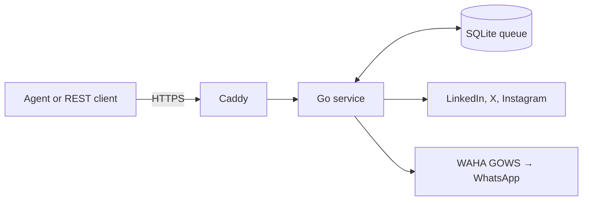

# social-mcp

[](https://github.com/carlosmezquita/social-mcp/actions/workflows/ci.yml)

A Go service that lets agents schedule and publish social posts over MCP or REST. It stores each delivery in SQLite so queued work survives a restart and campaigns can track each destination independently.

## Architecture



- **Durable queue.** MCP and REST use the same scheduler. SQLite tracks delivery state and attempts. Campaign creation uses an idempotency key scoped to the caller.
- **Safe retries.** Confirmed transient failures and rate limits use bounded backoff. A write with an unknown outcome moves to `uncertain` for manual review.
- **Scoped access.** Credentials are encrypted at rest. Each principal has an account allowlist, with recipient-level restrictions for WhatsApp.
- **Small deployment.** The Go binary runs under systemd behind Caddy. WAHA uses Docker and listens on loopback.

| Platform | Implemented provider requests |
| --- | --- |
| WhatsApp | Direct and group messages, automatic or custom link previews, media and acknowledgement lookup |
| LinkedIn | Member and organization posts with text, links, articles, images or video |
| X | Text, links, images and video using user-context OAuth |
| Instagram | Professional-account JPEG posts and MP4 Reels |

Each delivery accepts one media attachment. Custom WhatsApp previews can include a separate thumbnail.

## Run the demo

On Linux with Go 1.27.4, Python 3, curl and Caddy installed:

```bash
git clone https://github.com/carlosmezquita/social-mcp.git
cd social-mcp
make check
make release
python3 tests/smoke.py
```

The smoke test starts the service behind Caddy over local HTTPS, initializes MCP, checks authorization and OAuth routing, restarts the Go process with a queued delivery, and verifies the mock WhatsApp send and SQLite backup. It uses a mock WAHA server and requires no external account credentials. Live publishing and preview rendering need a separate provider-account check.

## Explore the code

| Area | Start here |
| --- | --- |
| Scheduling, retries and idempotency | [Service](internal/app/service.go) · [SQLite store](internal/app/store.go) |
| API surface and access control | [MCP tools](internal/app/mcp.go) · [HTTP handlers](internal/app/http.go) |
| Provider integrations | [Social APIs](internal/app/social.go) · [WhatsApp adapter](internal/app/whatsapp.go) |
| Testing | [Scheduler and API tests](internal/app/app_test.go) · [HTTPS smoke test](tests/smoke.py) |
| Self-hosting | [Ubuntu deployment and recovery](docs/deployment.md) · [Authentication](docs/authentication.md) · [Publishing examples](docs/examples.md) |
